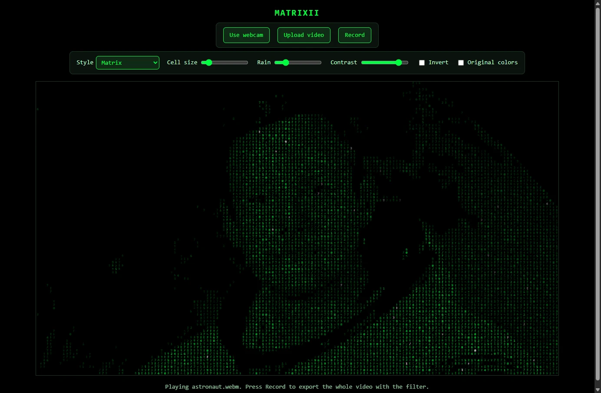
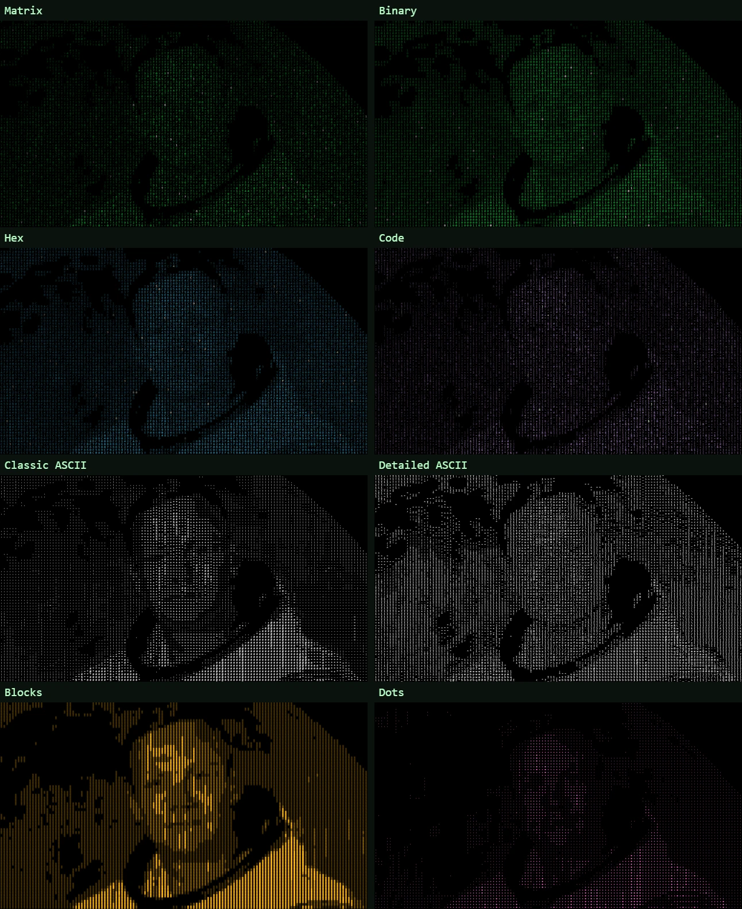
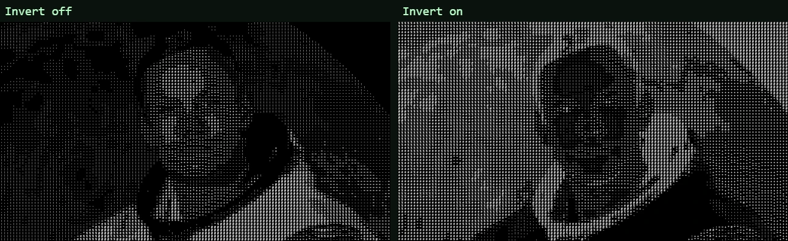
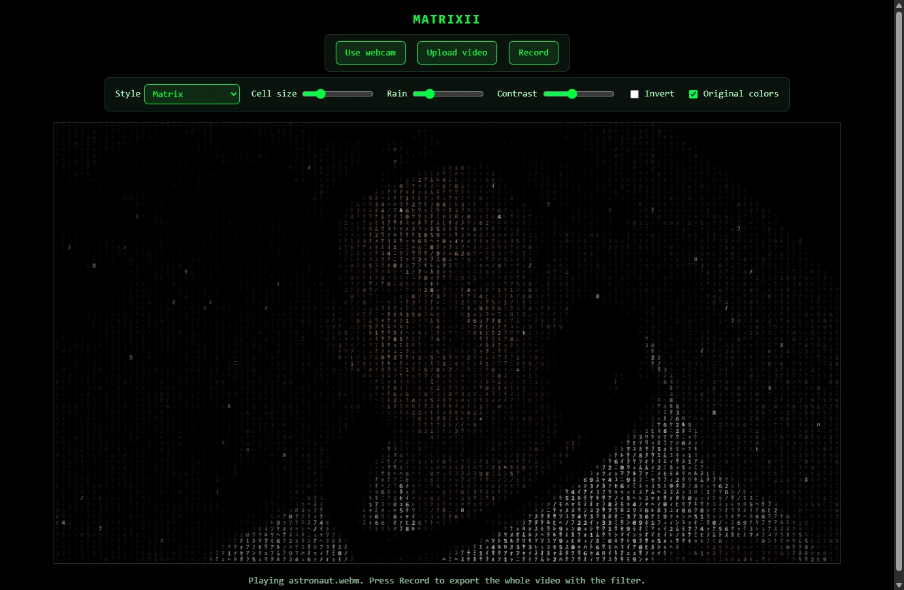
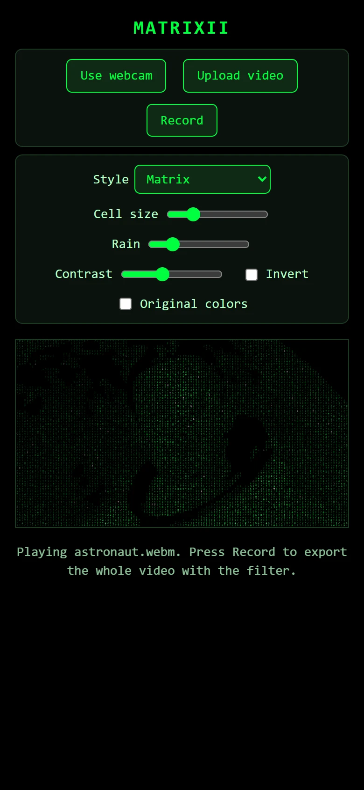
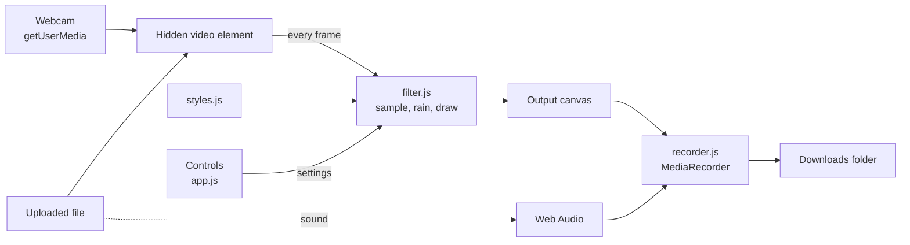

# Matrixii

Turn your webcam or any video into Matrix digital rain, right in your browser.

Matrixii redraws every frame of a video as a grid of falling characters: katakana and digits like the film, or binary, hex, code symbols, classic ASCII art, shaded blocks and dots. Use it live with your webcam, or upload a video, convert it and download the result with its original sound. No account, no server and no install. Your video never leaves your computer.

**Live:** https://matrixii.vercel.app

[](https://vercel.com/new/clone?repository-url=https%3A%2F%2Fgithub.com%2F4bdulllahh%2FMatrixii&project-name=matrixii&repository-name=matrixii)
[](LICENSE)



## Features

- **Live webcam.** Click **Use webcam** and see yourself in the filter as you move. The picture is mirrored, so it behaves like a mirror.
- **Convert your own videos.** Click **Upload video** and pick any video your browser can play (MP4, WebM, MOV on most computers). It plays in the filter straight away, on a loop.
- **Export with sound.** Press **Record** on an uploaded video and Matrixii plays it from the start and records the filtered version until the end, with the original audio. On the webcam, Record and Stop save a clip of any length.
- **Eight styles.** Matrix, Binary, Hex, Code, Classic ASCII, Detailed ASCII, Blocks and Dots. Four draw random characters whose brightness follows the picture; four pick each character by how bright that spot is, like real ASCII art.
- **Falling rain.** Every column has its own drop falling at its own speed, lighting up the picture as it passes, with a bright white head on the Matrix-like styles. The **Rain** slider sets how strong it is, from none to the picture only showing inside the trails.
- **Made to see yourself.** **Invert** swaps light and dark, which helps in front of a bright wall or window. **Contrast** separates you from the background. Mid-tones such as skin are lifted so faces stay visible.
- **Original colors.** Tick **Original colors** to draw every character in the color of the video underneath it instead of the style's color.
- **Adjustable detail.** **Cell size** sets the character size from 6 to 24 pixels: small for detail, large for a bold, blocky look.
- **Private.** Everything happens in your browser. Nothing is uploaded, stored or tracked.
- **Nothing to install.** It is a web page. Open the live site, or download this repo and double-click `index.html`.

| Every style on the same frame | Invert off and on |
| --- | --- |
|  |  |

| Original colors | On a phone |
| --- | --- |
|  |  |

## How to use

1. Open https://matrixii.vercel.app (or `index.html` from this repo).
2. Click **Use webcam** and allow camera access, or click **Upload video** and pick a file.
3. Pick a **Style** and adjust the sliders until you like it. If you are hard to see, raise **Contrast**, lower **Rain**, or turn on **Invert**.
4. Press **Record**.
   - **Webcam:** recording starts at once. Press **Stop** to save the clip.
   - **Uploaded video:** the video restarts and the whole thing is exported. It stops by itself at the end, or press **Stop export** to finish early.

Recordings are saved to your Downloads folder as `matrixii-<time>.mp4` in Chrome and Edge, or `.webm` in Firefox.

### Controls

| Control | Range | Default | What it does |
| --- | --- | --- | --- |
| Style | 8 styles | Matrix | Which characters are drawn and in what color |
| Cell size | 6 to 24 px | 10 | Size of each character; smaller means more detail |
| Rain | 0 to 100% | 20% | How much of the picture only shows inside falling trails |
| Contrast | 50 to 300% | 150% | Pushes light and dark apart around mid-grey |
| Invert | on or off | off | Swaps light and dark |
| Original colors | on or off | off | Uses the video's own colors instead of the style's |

## Styles

| Style | Characters | Type | Color |
| --- | --- | --- | --- |
| Matrix | Half-width katakana and digits | Random, brightness sets opacity | Green |
| Binary | `0 1` | Random, brightness sets opacity | Green |
| Hex | `0` to `9`, `A` to `F` | Random, brightness sets opacity | Blue |
| Code | `{ } [ ] ( ) < > / \ ; : = + - * & \| ! ? # $` | Random, brightness sets opacity | Purple |
| Classic ASCII | ` .:-=+*#%@` | Picked by brightness | White |
| Detailed ASCII | 70 characters from space to `$` | Picked by brightness | White |
| Blocks | ` ░▒▓█` | Picked by brightness | Amber |
| Dots | ` ·•●` | Picked by brightness | Pink |

The random styles flicker: each character has a small chance of changing every frame, and the head of every rain drop always does. The brightness-picked styles show more detail, so faces and edges read better there.

Adding a style is one line in [`js/styles.js`](js/styles.js): a name, the characters, whether they are a brightness ramp, and a color.

## Privacy

Matrixii has no backend. The page is a handful of static files; once they load, it makes no network requests. Your webcam feed and your videos are read by your own browser and drawn onto the page, and recordings are built in memory and handed straight to your Downloads folder. Nothing is uploaded, there are no analytics or cookies, and nothing is saved between visits.

## Principles

- **Zero install.** No Python, no OpenCV, no packages, no build step. If it has a modern browser, it runs.
- **Works from disk.** The scripts are plain files rather than modules, so double-clicking `index.html` works without a server.
- **Zero cost.** A static site on Vercel's free tier, with nothing to run or pay for.
- **Small and readable.** Seven short files, each with one job.

## Tech stack

| Area | Choice |
| --- | --- |
| Language | Plain JavaScript, HTML and CSS, no framework and no dependencies |
| Drawing | Canvas 2D: one `fillText` per character |
| Webcam | `getUserMedia` |
| Video sound | Web Audio API (`createMediaElementSource`) |
| Recording | `canvas.captureStream` and `MediaRecorder` |
| Hosting | Vercel, zero configuration |

## How the filter works

[`js/filter.js`](js/filter.js) runs once per animation frame.

1. **Shrink the frame.** The video is drawn onto a hidden canvas with one pixel per character cell, so the browser does the averaging. At the default cell size a 1280 x 720 picture becomes a 128 x 72 grid. The output is at most 1280 pixels wide.
2. **Measure brightness.** Each cell's brightness is `0.299 R + 0.587 G + 0.114 B`, the standard weighting for how bright colors look to people. **Invert** flips it, then **Contrast** stretches it around mid-grey.
3. **Add the rain.** Each column has a drop moving down 0.2 to 0.6 rows per frame, with a trail 40% of the screen tall that fades from its head. A cell's final brightness is its picture brightness, dimmed by the **Rain** amount where there is no trail and boosted where there is one. Drops restart above the screen at a new speed once their trail has left the bottom.
4. **Pick the character.** Brightness-picked styles choose from their list, dark to light, and skip blank cells. Random styles keep a character per cell and draw it with an opacity of the square root of the brightness, which lifts mid-tones so faces don't fade into the background.
5. **Draw.** Cells too dark to see are skipped. The rest are drawn with `fillText`, in the style's color, the video's own color, or white for the head of a drop.

The webcam is mirrored horizontally when it is sampled. Changing the cell size, the style or the video's size rebuilds the grid.

## How recording works

[`js/recorder.js`](js/recorder.js) records the output canvas at 30 frames per second and 8 Mbit/s, as MP4 where the browser supports it (Chrome, Edge) and WebM otherwise (Firefox).

For an uploaded video, its sound is routed through Web Audio once ([`js/sources.js`](js/sources.js)), so it can go both to your speakers and into the recording. Recording an upload rewinds it, turns off looping and stops when the video ends, so the export matches the original's length. Webcam clips have no sound.

## Architecture



| File | What's in it |
| --- | --- |
| [`index.html`](index.html) | The page: two control bars, the output canvas and the hidden video |
| [`css/style.css`](css/style.css) | All styling: theme colors, control bars, output |
| [`js/styles.js`](js/styles.js) | The eight styles |
| [`js/filter.js`](js/filter.js) | The grid, the rain and the drawing |
| [`js/sources.js`](js/sources.js) | Starting the webcam, loading a file and routing its sound |
| [`js/recorder.js`](js/recorder.js) | Recording the canvas and downloading the file |
| [`js/app.js`](js/app.js) | Connects the controls to everything above and runs the frame loop |

## Accessibility

- Every control is a native button, slider, dropdown or checkbox with a visible label, so the whole app works from the keyboard and with screen readers.
- Buttons show a clear focus state.
- The output itself is visual: there is no text description of what is on screen.

## Getting started

There is nothing to build. Clone the repo and open `index.html`, or serve the folder to test the webcam the way the live site runs:

```bash
git clone https://github.com/4bdulllahh/Matrixii.git
cd Matrixii
python -m http.server     # then open http://localhost:8000
```

Any static server works (`npx serve`, for example).

## Deploy your own

- **Vercel:** click **Deploy with Vercel** above. No configuration is needed.
- **Any static host:** upload the files as they are. GitHub Pages and Netlify work too.

## Limitations

- **Export runs in real time.** A three-minute video takes three minutes to export. Keep the tab open and visible: browsers slow down hidden tabs, which would drop frames from the export.
- **Webcam from a file on disk.** Some browsers block the camera on pages opened straight from disk. Use the live site or a local server (see Getting started).
- **File types.** Matrixii can convert any video your browser can play. Some formats, such as certain MOV or MKV files, may not play in every browser.
- **Fine detail in random styles.** Matrix, Binary, Hex and Code show shapes and outlines well but small features less so, because only brightness changes. Classic ASCII, Detailed ASCII and Blocks show faces in more detail.
- **Slow computers.** Small cell sizes draw many thousands of characters every frame. If it stutters, raise the cell size.
- **Safari** has not been tested.

## Credits

The screenshots use the official 1969 NASA portrait of Neil Armstrong, which is in the public domain ([Wikimedia Commons](https://commons.wikimedia.org/wiki/File:Neil_Armstrong_pose.jpg)).

## License

MIT
